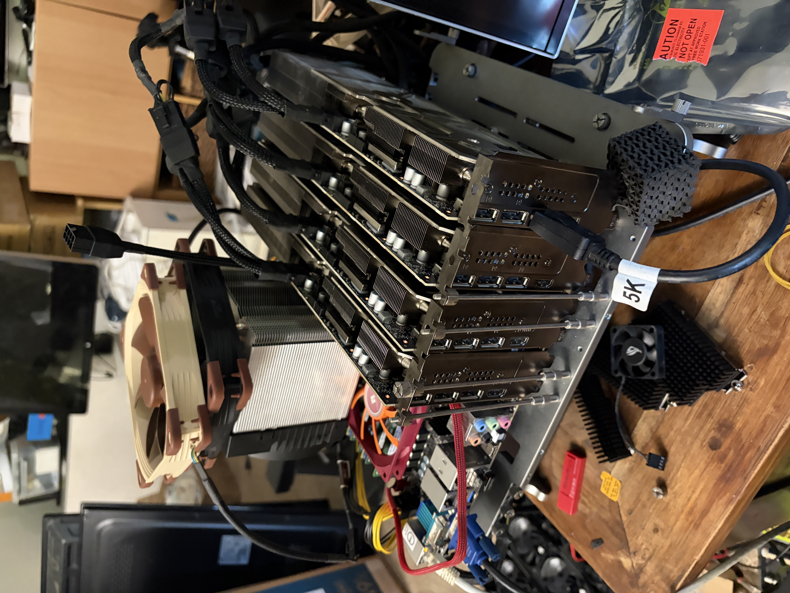

The original plan was exploring frontier AI performance on a budget (with the release of Kimi K3) using the [K-transformers](https://github.com/kvcache-ai/ktransformers) library, however, despite succeeding, the speed made it impractical, so I pivoted to building a general purpose AI inference/ training (and generally awesome mini-supercomputer).

The part rationale was driven by a few main factors namely:
- What is the cheapest route to achieve 2TB of DRAM (and at what kind of bandwidth)?
- What platform has the best GPU support (PCIe bandwidth, MMIO space, etc) and many of them?
- CPU instruction-set extension support? (AVX2 bare-minimum, AVX512 preferrably, AMX nice to have)

Ultimately I settled on three potential candidates:
- Ultra low end: DDR3-based quad-socket (or even 8S) server
    - pros: cheap (already have lol), 2TB of ram, decent bandwidth (85*4GB/s or 8), AVX2 IF broadwell support is hacked in
    - cons: very very power inefficient, no AVX512 or AMX, no GPU support (or atleast not without janky mods), AVX2 requires bios cross-flashing a newer model (memory controller is external for that particular xeon familly)
- Mid end: Xeon Ice-Lake, last generation of DDR4 Xeons
    -pros: DDR4 Optane 200 support, 512GB DDR4 [*PMEM*](https://www.servethehome.com/intel-optane-dc-persistent-memory-guide-for-pmem-100-pmem-200-and-pmem-300-optane-dimms/) dimms for $230/each. AVX512 support, good GPU support (PCIe gen4, 64-lanes per CPU, 2021 platform). 205.6GB/s max theoretical bandwidth per CPU.
    -cons: optane isin't "real" dram and performance may suffer a result. still requires normal expensive DDR4 rdimms. No AMX which for the price is a bummer and hurts K-Transformers 

finish later tbh